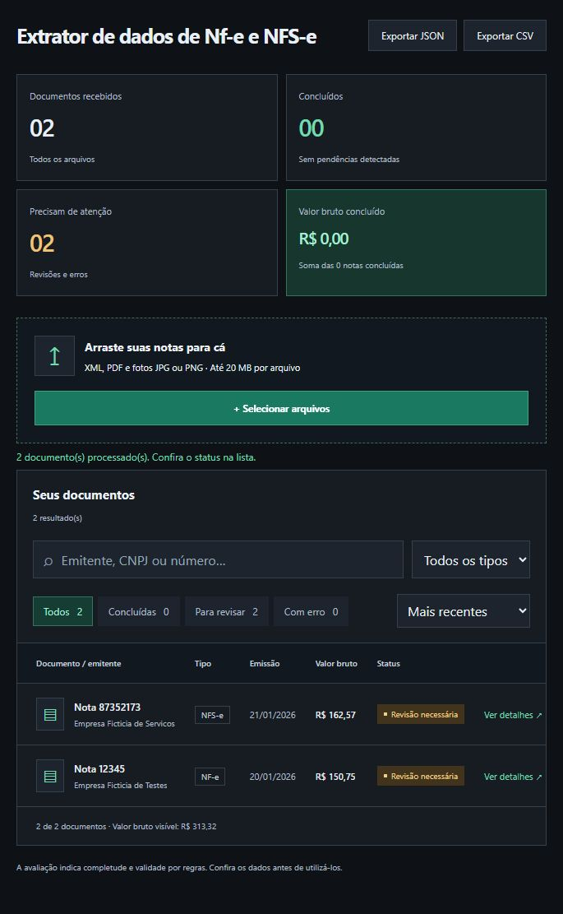

# Extrator de notas fiscais

Aplicação para organizar dados de **NF-e e NFS-e** a partir de arquivos XML, PDF, JPG e PNG. Ela lê o documento, extrai campos como número, emitente, destinatário, data e valor, valida os identificadores e indica se a nota está concluída ou precisa de revisão.



*Captura da aplicação com documentos fictícios. Eles aparecem para revisão porque contêm identificadores inválidos de propósito.*

## O que a aplicação oferece

- Leitura de XML e PDF, com OCR por Tesseract para imagens e páginas digitalizadas.
- Auxílio opcional do Gemini para preencher campos essenciais que a leitura local não encontrou.
- Painel com prévia do arquivo, busca, filtros, detalhes e exportação em JSON ou CSV.
- Processamento em lote local para quem prefere colocar arquivos em uma pasta.

Na interface web, cada upload é processado pela API e o arquivo temporário é apagado ao final. Resultados e prévias ficam somente na memória da aba: **recarregar ou fechar a página descarta a lista**. O modo de lote, por outro lado, salva JSON, CSV e SQLite no computador.

**Tecnologias:** Python e FastAPI no backend; pypdf, PyMuPDF e Tesseract na leitura; React, TypeScript e Vite na interface; SQLite apenas no lote local.

## Como executar

O projeto foi verificado no Windows com Python 3.14 e Node.js 24. Use Python **3.12 ou superior** e Node.js **22.12 ou superior**. Para ler fotos e PDFs escaneados, instale também o **Tesseract OCR** com o idioma português (`por`). XML e PDFs com texto não precisam do Tesseract.

Na raiz do projeto, abra o PowerShell e instale as dependências:

```powershell
python -m venv .venv
.\.venv\Scripts\python.exe -m pip install -r requirements.txt
npm --prefix frontend ci
if (-not (Test-Path .env)) { Copy-Item .env.example .env }
```

O backend lê o `.env` automaticamente na inicialização. Se o Tesseract não estiver no `PATH`, informe nele o caminho do executável, por exemplo `TESSERACT_CMD=C:/Program Files/Tesseract-OCR/tesseract.exe`.

Inicie o backend em um terminal:

```powershell
.\.venv\Scripts\python.exe -m uvicorn api:app --host 127.0.0.1 --port 8000
```

Em outro terminal, inicie a interface:

```powershell
npm --prefix frontend run dev
```

Abra **http://127.0.0.1:5173/**, selecione ou arraste um arquivo e confira os campos em **Ver detalhes**. A API também pode ser explorada em **http://127.0.0.1:8000/docs**. Cada arquivo deve conter uma nota fiscal.

Para experimentar sem dados reais, use os documentos de `testes/fixtures/` ou gere exemplos em uma pasta separada:

```powershell
.\.venv\Scripts\python.exe gerar_demo.py --saida resultados/demo
```

## Gemini opcional

O processamento começa sempre pela leitura local. O Gemini só é chamado quando falta um campo essencial e as opções abaixo estão habilitadas no `.env`:

```dotenv
GEMINI_API_KEY=sua-chave
IA_HABILITADA=1
IA_ENVIO_AUTORIZADO=1
IA_ENVIO_IMAGEM=0
```

Reinicie o backend após alterar o arquivo. Com `IA_ENVIO_IMAGEM=0`, a IA recebe trechos do texto extraído; com `IA_ENVIO_IMAGEM=1`, fotos incompletas também podem ser enviadas ao Google. Esses trechos ou imagens podem conter dados fiscais e pessoais. O modelo principal é Gemini 3.6 Flash, com 3.5 Flash-Lite como alternativa quando o primeiro permanece indisponível. Falhas de cota ou conexão preservam a extração local.

## Processamento em lote

Coloque os documentos em `entrada/` e execute o comando abaixo na raiz:

```powershell
.\.venv\Scripts\python.exe main.py
```

O lote organiza os arquivos em `processados/`, `revisao/` ou `erros/` e grava os resultados em `resultados/` e `notas.sqlite3`. Essas pastas e o banco são ignorados pelo Git. A API web não usa o banco de dados do lote.

## Testes

```powershell
.\.venv\Scripts\python.exe -m pip install -r requirements-dev.txt
.\.venv\Scripts\python.exe -m pytest -q
npm --prefix frontend run build
```

Os testes automatizados não fazem chamadas reais ao Gemini. Para verificar OCR com o Tesseract instalado, defina `$env:TESTAR_OCR_REAL='1'` antes de executar o pytest.

## Privacidade e limites

O `.env` com a chave de API não é versionado. A interface web não mantém um histórico no servidor e não exige login; por isso, execute-a apenas em ambiente local ou acrescente autenticação e proteção de infraestrutura antes de hospedá-la publicamente. Exportações JSON/CSV ficam no dispositivo de quem fez o download.

Os dados extraídos devem ser conferidos antes de uso fiscal. O projeto não valida a nota junto à SEFAZ ou às prefeituras, não verifica assinatura digital e não separa várias notas dentro de um mesmo arquivo. Layouts incomuns e imagens de baixa qualidade podem deixar campos pendentes.
