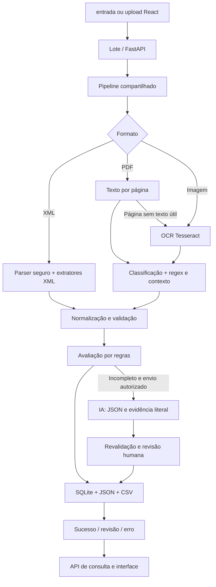

# Automação de notas fiscais

Extração local de **NF-e e NFS-e** em XML, PDF, PNG e JPEG, com organização em JSON, CSV e SQLite. API FastAPI e interface React + TypeScript + Vite. IA opcional apenas para extrações incompletas e mediante autorização explícita.

O painel usa tema escuro com cantos retos. As capturas em `docs/` mostram versões anteriores da interface e servem apenas como histórico do projeto.

## Instalação

Ambiente verificado: Windows, Python 3.14, Node.js 24 e Tesseract com o idioma `por`. Use Python 3.12+ e Node.js 22.12+; outras versões/sistemas não foram verificados nesta entrega.

Na raiz do projeto, no PowerShell:

```powershell
python -m venv .venv
.\.venv\Scripts\python.exe -m pip install -r requirements-dev.txt
npm --prefix frontend ci
```

Para executar apenas o backend, `requirements.txt` é suficiente. SQLite faz parte do Python. Não é necessário instalar servidor de banco, SDK de IA ou bibliotecas de interface adicionais.

### Tesseract

Instale o Tesseract e os dados de idioma português (`por`), conforme a [documentação de instalação](https://tesseract-ocr.github.io/tessdoc/Installation.html). No Windows, configure o caminho correspondente à sua instalação:

```powershell
$env:TESSERACT_CMD = 'C:/Program Files/Tesseract-OCR/tesseract.exe'
$env:OCR_LANG = 'por'
& $env:TESSERACT_CMD --list-langs
```

No Linux, os pacotes usuais são `tesseract-ocr` e `tesseract-ocr-por`. Se o executável estiver no `PATH`, `TESSERACT_CMD` é dispensável. No Windows, o sistema também procura a instalação em `ProgramFiles/Tesseract-OCR` e `LOCALAPPDATA/Tesseract-OCR`. Sem Tesseract, XML e PDFs com texto continuam funcionando; imagens e páginas escaneadas registram erro de OCR.

## Executar a aplicação

Terminal 1, na raiz:

```powershell
$env:TESSERACT_CMD = 'C:/Program Files/Tesseract-OCR/tesseract.exe'
.\.venv\Scripts\python.exe -m uvicorn api:app --host 127.0.0.1 --port 8000
```

Terminal 2:

```powershell
npm --prefix frontend run dev
```

Abra [a interface](http://127.0.0.1:5173) e [o Swagger](http://127.0.0.1:8000/docs). O Vite encaminha `/api` ao backend local. Faça upload de um ou mais arquivos ou use drag & drop. Pesquise por CNPJ/número, filtre NF-e/NFS-e e abra **Ver detalhes** para comparar os dados extraídos com o arquivo original: foto, PDF ou XML.

A API é síncrona: o upload retorna o status final. A interface indica processamento enquanto aguarda a resposta. Use uma instância do backend, com um worker; esta versão é uma ferramenta local, sem autenticação ou fila distribuída. Não execute lote e API simultaneamente sobre a mesma pasta de dados: SQLite protege as inserções, mas as exportações em arquivo não têm coordenação entre processos.

Para gerar e verificar o build:

```powershell
npm --prefix frontend run build
npm --prefix frontend run preview
```

O preview também requer a API na porta 8000. A pasta `frontend/dist/` não contém backend e não deve ser publicada isoladamente esperando processamento fiscal.

## Processamento em lote

Coloque cópias dos documentos em `entrada/` e execute:

```powershell
.\.venv\Scripts\python.exe main.py
```

As pastas são criadas automaticamente. Defina `DADOS_DIR` para isolar os dados operacionais:

```powershell
$env:DADOS_DIR = 'C:/dados/notas-demo'
.\.venv\Scripts\python.exe main.py
```

Configure a mesma variável no terminal da API se quiser compartilhar esse banco. Por padrão, o diretório é a raiz do projeto.

| Destino | Conteúdo |
| --- | --- |
| `processados/` | Documentos sem ausências obrigatórias ou inconsistências detectadas |
| `revisao/` | Extrações incompletas, identificadores inválidos ou campos preenchidos por IA |
| `erros/` | Arquivos que não puderam ser lidos/classificados/extraídos |
| `duplicados/` | Cópias adicionais preservadas quando o destino já existe |
| `resultados/registros/<id>.json` | Resultado por nota, origem, status, erro e horário UTC |
| `resultados/notas.csv` | Consolidado com uma linha por nota extraída, inclusive em revisão |
| `resultados/resumo.json` | Contadores da última execução do lote |
| `notas.sqlite3` | Notas e associação dos hashes dos arquivos |

Documentos são movidos apenas depois da persistência/exportação. Se ocorrer falha operacional, o lote continua e mantém a entrada para recuperação. Falhas de extração também ficam registradas no banco/JSON; não viram linhas fiscais fictícias no CSV. A função legada `main.processar_arquivo()` permanece disponível para extrair/exportar um arquivo individual sem movê-lo.

A duplicidade é identificada por SHA-256 do conteúdo e, quando disponível, chave fiscal. Chaves NF-e com dígito inválido não são usadas como identidade. Arquivos com falha/revisão também são lembrados para evitar repetições e chamadas de IA. Ao reenviar um arquivo em erro/revisão registrado por uma versão antiga do extrator, o sistema reavalia e atualiza a mesma nota, sem criar outra linha. Resultados da versão atual continuam protegidos contra duplicação. Para repetir a mesma versão após mudar apenas configurações, utilize um novo `DADOS_DIR`. Sem chave confiável, representações diferentes da mesma nota podem exigir conferência manual.

## Exemplos fictícios

A pasta `exemplos/` contém NF-e/NFS-e XML, PDFs com texto, PDF escaneado, JPG, PNG e XML não fiscal. Todos os nomes e identificadores são fictícios. Identificadores zerados e chaves repetidas são intencionais: essas notas devem ir para **revisão**, não ser consideradas fiscalmente válidas.

```powershell
.\.venv\Scripts\python.exe gerar_demo.py
# Ou gere diretamente em uma pasta de demonstração isolada:
.\.venv\Scripts\python.exe gerar_demo.py --saida C:/dados/notas-demo/entrada
```

O gerador sobrescreve somente os nomes de exemplo conhecidos no destino indicado. Não aponte para uma pasta com documentos de produção que tenham esses nomes.

## Arquitetura



- `extratores/`: regras de NF-e/NFS-e em XML e texto de PDFs/imagens; reaproveitadas do projeto original.
- `processamento/leitor.py` e `ocr.py`: leitura por página e OCR com `--psm 3`, renderização de PDF a 300 DPI e pré-processamento condicional.
- `normalizador.py`, `validador.py`, `avaliador.py`: datas/valores/identificadores, dígitos verificadores e diagnóstico.
- `pipeline.py`: coordena extração local, normalização, IA opcional e reavaliação; não move arquivos.
- `ia.py`: uma chamada opcional à Responses API, JSON Schema, evidências e métricas.
- `lote.py`: tratamento por arquivo, organização das pastas, logs e exportações.
- `banco.py`: persistência SQLite transacional e consultas parametrizadas, sem ORM.
- `api.py`: uploads e consultas; reutiliza o mesmo processamento do lote.
- `frontend/`: interface responsiva, sem biblioteca visual adicional.

### Mapa dos arquivos

Esta é a ordem sugerida de leitura para estudar o projeto: `api.py` ou `main.py` → `processamento/pipeline.py` → leitores/extratores → normalização/avaliação → persistência. O frontend consulta a mesma API usada pelo upload.

| Arquivo | Responsabilidade |
| --- | --- |
| `api.py` | Cria o FastAPI; valida uploads, lista, consulta, serve a prévia do original e exclui registros. |
| `main.py` | Entrada do processamento em lote e funções de compatibilidade para um arquivo. |
| `gerar_demo.py` | Gera exemplos fictícios para estudo, sem dados reais. |
| `processamento/pipeline.py` | Coordena leitura, extração, normalização, avaliação e eventual tentativa com IA. Define formatos e versão do extrator. |
| `processamento/leitor.py` | Extrai texto de PDF e imagem; recorre ao OCR em páginas sem texto útil. |
| `processamento/leitor_xml.py` | Reconhece a estrutura do XML e escolhe o extrator correspondente. |
| `processamento/ocr.py` | Prepara imagens, encontra o Tesseract e relê regiões de DANFE. |
| `processamento/classificador_fiscal.py` | Identifica NF-e ou NFS-e no texto de PDF/foto. |
| `processamento/normalizador.py` | Converte datas, CPF/CNPJ e valores para um formato comum. |
| `processamento/validador.py` | Verifica dígitos de CPF, CNPJ e chave de acesso. |
| `processamento/avaliador.py` | Aponta campos obrigatórios ausentes e inconsistências; determina necessidade de revisão. |
| `processamento/ia.py` | Executa o fallback opcional, limitado a campos ausentes e evidências literais. |
| `processamento/lote.py` | Identifica duplicatas, processa arquivos, organiza pastas e exporta JSON/CSV. |
| `processamento/banco.py` | Cria e consulta o SQLite; persiste, atualiza e exclui notas e hashes associados. |
| `extratores/campos_layout.py` | Lê campos de tabelas em colunas sem atribuir números a rótulos errados. |
| `extratores/nfe_pdf.py` | Extrai campos de DANFE em texto de PDF ou OCR. |
| `extratores/nfse_pdf.py` | Extrai campos de NFS-e em texto de PDF ou OCR. |
| `extratores/nfe_xml.py` | Extrai NF-e do XML do Portal Fiscal. |
| `extratores/nfse_xml.py` | Extrai NFS-e de XML ABRASF ou municipal paulistano. |
| `frontend/src/main.tsx` | Tela React: upload, lista, filtros, detalhes e exclusão. |
| `frontend/src/style.css` | Layout responsivo, cores do tema escuro e estados visuais. |
| `frontend/index.html` | Documento HTML inicial, metadados e ponto de montagem do React. |
| `frontend/vite.config.ts` | Configura o proxy `/api` do Vite para o FastAPI local. |
| `frontend/tsconfig.json` | Regras de compilação e checagem do TypeScript. |
| `frontend/src/vite-env.d.ts` | Tipos do ambiente Vite usados pelo frontend. |
| `frontend/package.json` | Scripts de desenvolvimento/build e dependências declaradas. |
| `frontend/package-lock.json` | Versões exatas resolvidas pelo npm para instalação reproduzível. |
| `requirements.txt` | Bibliotecas Python necessárias para executar a aplicação. |
| `requirements-dev.txt` | Dependências adicionais da suíte de testes. |
| `.env.example` | Exemplo de variáveis de ambiente; não é carregado automaticamente. |
| `.gitignore` | Impede que banco, credenciais, caches e documentos operacionais entrem no Git. |
| `pytest.ini` | Registra a marca dos testes opcionais com OCR real. |
| `testes/__init__.py` | Torna os utilitários de teste importáveis como pacote. |
| `testes/conftest.py` | Fixtures comuns; bloqueia chamadas externas de IA durante a suíte. |
| `testes/dados_ficticios.py` | Cria os documentos sintéticos usados no gerador e nos testes. |
| `testes/test_api.py` | Exercita validação do upload, consultas e exclusão HTTP. |
| `testes/test_banco.py` | Exercita persistência SQLite e identificação de duplicatas. |
| `testes/test_ia.py` | Verifica autorizações, resposta estruturada e evidências sem chamada externa real. |
| `testes/test_avaliador.py` | Verifica completude, validade e necessidade de revisão. |
| `testes/test_validadores.py` | Verifica CPF, CNPJ, chave de acesso e regras de dígito. |
| `testes/test_ocr.py` | Verifica leitura de imagens, PDFs escaneados e descoberta do Tesseract. |
| `testes/test_classificador.py` | Verifica o reconhecimento de NF-e/NFS-e no texto. |
| `testes/test_extracao_pdf.py` | Exercita os extratores de PDF com exemplos sintéticos. |
| `testes/test_extracao_xml.py` | Exercita os extratores de XML e formatos desconhecidos. |
| `testes/test_nfse_layouts.py` | Verifica variações de apresentação da NFS-e. |
| `testes/test_layouts_municipais.py` | Verifica colunas e XML municipal, inclusive regressões. |
| `testes/test_lote.py` | Exercita processamento em lote e organização de pastas. |
| `testes/test_integracao.py` | Verifica o fluxo de ponta a ponta entre componentes. |
| `testes/test_regressao.py` | Protege casos de erro já corrigidos. |
| `testes/fixtures/nfe_teste.xml` | NF-e XML fictícia para verificar o extrator. |
| `testes/fixtures/nfse_teste.xml` | NFS-e XML fictícia para verificar o extrator. |
| `testes/fixtures/xml_desconhecido.xml` | XML sem estrutura fiscal reconhecida. |
| `testes/fixtures/danfe_teste.pdf` | DANFE fictício de referência. |
| `testes/fixtures/danfe_teste2.pdf` | Segundo layout de DANFE fictício. |
| `testes/fixtures/danfse_teste.pdf` | Layout de NFS-e fictícia. |
| `exemplos/nfe_teste.xml` | NF-e XML fictícia para execução manual. |
| `exemplos/nfse_teste.xml` | NFS-e XML fictícia para execução manual. |
| `exemplos/xml_desconhecido.xml` | Exemplo de XML não fiscal. |
| `exemplos/danfe_teste.pdf` | Exemplo de DANFE em PDF. |
| `exemplos/danfe_teste2.pdf` | Exemplo de outro layout de DANFE. |
| `exemplos/danfse_teste.pdf` | Exemplo de NFS-e em PDF. |
| `exemplos/nfse_escaneada.pdf` | Exemplo de PDF escaneado que requer OCR. |
| `exemplos/nfse_imagem.jpg` | Foto fictícia de NFS-e para testar OCR JPEG. |
| `exemplos/nfse_imagem.png` | Imagem fictícia de NFS-e para testar OCR PNG. |
| `docs/RELATORIO.md` | Relatório das fases, decisões e validações do projeto. |
| `docs/interface.jpg` | Captura histórica da interface em desktop. |
| `docs/interface-mobile.jpg` | Captura histórica da interface estreita. |

`entrada/`, `processados/`, `revisao/`, `erros/`, `duplicados/`, `uploads/`, `resultados/`, `notas.sqlite3`, `.venv/`, `frontend/node_modules/` e `frontend/dist/` são dados ou artefatos gerados localmente; não são código-fonte do projeto.

O formato original (`tipo`, `numero_nota`, `emitente`, `destinatario`, datas e `valor_total`) foi preservado. Foram acrescentados campos de líquido/ISS, `vencimentos`, validações, avaliação e metadados. `valor_total` representa **valor bruto**. `data_vencimento` mantém o primeiro vencimento encontrado; `vencimentos` preserva todas as datas identificadas. Ausência é `null`, nunca um valor inventado. Os registros do lote/API envolvem esses dados na propriedade `dados` e acrescentam status e origem.

### Regras de qualidade

Campos obrigatórios comuns: número, CNPJ do emitente e valor bruto. Para NF-e/NFS-e identificadas, também data de emissão e documento do destinatário; NF-e exige chave. Vencimento não é obrigatório. Algumas operações legitimamente não identificam destinatário; a regra conservadora ainda as encaminha para revisão.

- **Completude:** percentual dos campos obrigatórios presentes; valor zero conta como presente.
- **Validade:** percentual dos identificadores presentes que passam nas verificações matemáticas. Não verifica existência cadastral, autorização fiscal ou assinatura.
- **Confiança estimada:** alta somente sem ausências e sem inconsistências detectadas; baixa nos demais casos. É uma heurística explícita, não uma probabilidade.
- Valor negativo, líquido superior ao bruto e identificadores inválidos exigem revisão. Valores não finitos são normalizados para ausência.
- Campos ausentes habilitam uma segunda tentativa via IA, somente para tipo fiscal já reconhecido e com texto disponível. Apenas identificador inválido não provoca chamada de IA.

## IA opcional e economia de tokens

O processamento local funciona sem chave. `.env.example` é uma referência de configuração; **não há carregamento automático de `.env`**. Para usar a faixa gratuita do Gemini, crie uma chave no [Google AI Studio](https://aistudio.google.com/app/apikey) e defina estas variáveis **no mesmo terminal em que iniciará o backend**:

```powershell
$env:IA_PROVEDOR = 'gemini'
$chaveGemini = Read-Host 'Chave Gemini' -AsSecureString
$env:GEMINI_API_KEY = [System.Net.NetworkCredential]::new('', $chaveGemini).Password
$env:IA_MODELO = 'gemini-2.5-flash'
$env:IA_HABILITADA = '1'
$env:IA_ENVIO_AUTORIZADO = '1'
# Opcional: autoriza enviar também a foto inteira quando faltarem campos.
$env:IA_ENVIO_IMAGEM = '1'
.\.venv\Scripts\python.exe -m uvicorn api:app --host 127.0.0.1 --port 8000
```

O modelo padrão de Gemini é `gemini-2.5-flash` quando `IA_MODELO` estiver vazio. Defina-o explicitamente ao migrar para evitar que um modelo OpenAI ainda presente no ambiente seja usado. Reinicie o backend após alterar as variáveis **ou atualizar o código**. A chave fica apenas no processo Python; nunca a coloque no frontend, em código versionado nem a envie no chat. O frontend continua usando a mesma API local. O nível gratuito está sujeito às [cotas e condições atuais do Gemini](https://ai.google.dev/gemini-api/docs/pricing); confira-as antes de processar notas reais. Segundo a tabela oficial de preços, o conteúdo do nível gratuito pode ser usado para melhorar os produtos do Google.

Para continuar usando OpenAI, defina `IA_PROVEDOR=openai`, `OPENAI_API_KEY` e um `IA_MODELO` compatível com [Structured Outputs na Responses API](https://developers.openai.com/api/docs/guides/structured-outputs). Sem `IA_PROVEDOR`, OpenAI continua sendo o padrão para instalações existentes.

**Quando a IA é acionada:** a decisão ocorre em `processamento/pipeline.py` depois da primeira extração local e da avaliação por regras. A chamada acontece apenas quando **todas** estas condições são verdadeiras:

1. O documento foi reconhecido como NF-e ou NFS-e e há texto de PDF ou OCR disponível. XML é extraído localmente e não fornece texto ao fallback.
2. Falta pelo menos um campo **obrigatório** avaliado por `processamento/avaliador.py`: número, CNPJ do emitente, valor bruto, data de emissão ou documento do destinatário; NF-e exige também a chave. Campos opcionais ausentes, como valor líquido/ISS, não bastam.
3. `IA_HABILITADA=1` **e** `IA_ENVIO_AUTORIZADO=1`, além da chave do provedor selecionado (`GEMINI_API_KEY` ou `OPENAI_API_KEY`) e de um modelo válido. Gemini usa `gemini-2.5-flash` se `IA_MODELO` não estiver definido.
4. O texto contém linhas com contexto fiscal suficientes para montar o trecho enviado.

Um arquivo repetido com resultado da versão atual retorna do cache antes dessa etapa. Um identificador apenas inválido, sem campo obrigatório ausente, solicita revisão sem chamar IA. Se qualquer condição falhar, `metadados.ia.utilizada` fica `false` e não há requisição externa.

Só habilite as opções depois de autorizar o envio dos dados envolvidos e verificar o tratamento adequado das informações. A autorização por ambiente se aplica aos documentos processados nessa execução. `IA_ENVIO_IMAGEM=1` é uma autorização separada para enviar fotos JPEG/PNG inteiras, além do texto OCR, apenas quando a extração local estiver incompleta. Os testes automatizados usam respostas simuladas, sem envio externo.

A integração Gemini usa [`generateContent` com saída JSON estruturada](https://ai.google.dev/gemini-api/docs/migrate-to-interactions) por `generationConfig.responseMimeType` e `responseJsonSchema`; a integração OpenAI usa a Responses API. Ambas passam pelo mesmo filtro local de evidências e validações. Após trocar o provedor ou atualizar a integração, reenvie uma nota em revisão para testá-la: registros concluídos e duplicatas da versão atual podem sair do cache sem chamar a IA. Consulte `metadados.ia.provedor`, `chamadas`, `erro` e `campos_aceitos` nos detalhes.

Para economizar, XML/texto/OCR e regex têm prioridade. O fallback recebe somente campos ausentes e trechos fiscais (até 12 mil caracteres), faz no máximo uma chamada por processamento e limita a saída a 1.800 tokens. Esse trecho pode conter nomes, identificadores e valores presentes no documento. Sem `IA_ENVIO_IMAGEM=1`, não envia imagens. Com ela, envia uma cópia JPEG reduzida da foto inteira (até 2048 px), que pode consumir tokens adicionais não cobertos pela estimativa simples de caracteres. Documentos completos, não fiscais ou sem texto não acionam a IA. Extrações XML não têm fallback externo nesta versão.

A resposta deve citar evidência literal, conter o valor nessa evidência e preencher apenas campos ausentes permitidos. No modo texto, a evidência precisa constar do OCR. No modo foto, identificadores, datas e valores também passam por verificações locais; mesmo assim, a evidência visual gerada pela IA não pode ser conferida automaticamente contra os pixels. Valores existentes são preservados e toda nota com campos aceitos da IA exige conferência humana. JSON inválido, recusa/resposta incompleta, timeout ou falha de rede preservam a extração local. Erros HTTP mostram o status e o código de máquina devolvido pela API (por exemplo, `HTTP 429 (credit_balance_exhausted)`), sem expor a chave, a mensagem livre nem o documento. Este código indica falta de créditos na organização, não um defeito do OCR.

Os metadados registram provedor, chamadas, uso de IA, campos aceitos, erro, estimativa simples de tokens de entrada e tokens retornados pela API. Custo estimado é calculado somente se forem definidos `IA_PRECO_ENTRADA_MILHAO` e `IA_PRECO_SAIDA_MILHAO` em USD; ajuste esses valores ao trocar de provedor. `store=false` é enviado apenas à OpenAI e não constitui garantia geral de retenção zero pelo serviço.

## API

| Método | Rota | Uso |
| --- | --- | --- |
| POST | `/api/upload` | Multipart com campo `arquivo`; limite de 20 MB |
| GET | `/api/notas` | Lista; `tipo`, `busca`, `limite` (1–500), `deslocamento` |
| GET | `/api/notas/{id}` | Registro completo |
| GET | `/api/notas/{id}/arquivo` | Arquivo original da nota cadastrada, para prévia de JPG/PNG, PDF e XML |
| DELETE | `/api/notas/{id}` | Exclui registro, aliases e exportação JSON; atualiza CSV e preserva arquivos originais |
| GET | `/api/processamentos/{id}` | Status final, erro e horário |
| GET | `/docs` | Swagger automático |

Valida extensão, tamanho, arquivo vazio e assinatura de PDF/imagem. A rota rejeita declarações DTD/entidades identificadas no conteúdo; o parser também impede expansão de entidades. MIME fornecido pelo cliente não é usado como prova de formato. Nome de upload não pode escolher caminhos fora da pasta temporária. Um upload aceito que falha na extração retorna HTTP 200 com `status=erro`; erros de validação do upload usam HTTP 400, 413 ou 415. Não há processamento assíncrono em segundo plano.

A interface oferece exclusão com confirmação, filtros de status, busca por emitente/CNPJ/número/arquivo, ordenação e resumo financeiro das notas concluídas. Nos detalhes, o original aparece ao lado dos dados em telas largas e acima deles em telas estreitas. A exclusão permite reenviar o documento para criar novamente o registro; depois dela a rota da prévia não serve mais o arquivo preservado.

## Testes

```powershell
.\.venv\Scripts\python.exe -m pytest -q
# OCR real opcional:
$env:TESSERACT_CMD = 'C:/Program Files/Tesseract-OCR/tesseract.exe'
$env:TESTAR_OCR_REAL = '1'
.\.venv\Scripts\python.exe -m pytest -q
npm --prefix frontend run build
```

Os testes automatizados cobrem o disparo do Gemini a partir do pipeline, o formato da requisição, tratamento de erro e as rotas de prévia, sem enviar notas a um serviço externo. O registro local mais recente de uma chamada Gemini retornou `HTTP 400 (INVALID_ARGUMENT)` antes da correção do formato JSON. A integração foi ajustada; a confirmação de uma resposta real bem-sucedida exige reiniciar o backend com a chave no ambiente e reenviar uma nota incompleta. Os PDFs, XML e `malaguNFE2.jpg` fornecidos anteriormente passaram na extração local; a foto antiga `malaguNFE.jpg` ainda requer revisão da chave de acesso, pois o OCR não a reproduz com segurança.

Para testar a leitura com cobertura útil, separe arquivos de **uma nota por documento**, com os valores corretos conhecidos para comparação:

| Documento | O que verifica |
| --- | --- |
| NF-e XML original e DANFE PDF da mesma nota | Campos, chave de 44 dígitos e consistência entre formatos |
| NFS-e XML original e PDF com texto selecionável da mesma nota | Número, prestador/tomador, bruto, líquido, ISS e data |
| DANFE e NFS-e digitalizados em PDF, sem texto selecionável | OCR em página escaneada |
| Fotos JPG e PNG de NF-e e NFS-e, inteiras, legíveis, de frente | OCR e envio opcional de imagem ao Gemini |
| Fotos inclinadas, com sombra/dobra e com rotação EXIF | Robustez do pré-processamento e limites de leitura |
| NFS-e de municípios ou provedores diferentes | Adaptação a layouts distintos |
| Nota com campo essencial ausente ou ilegível | Disparo da IA, evidência, revisão e preservação dos demais campos |
| Arquivo duplicado e PDF/imagem inválido | Cache, tratamento de erro e ausência de dados inventados |

Confira especialmente número, CNPJ/CPF, data de emissão, chave NF-e, valor bruto, líquido, ISS, vencimentos e o documento mostrado na prévia. Documentos de teste com dados anonimizados precisam manter os dígitos verificadores válidos quando a validação desses campos fizer parte do teste.

No navegador foram verificados upload de XML fictício, listagem, detalhe, pesquisa, filtro e estados de revisão; layouts de 390 px e desktop também foram inspecionados. [Captura estreita](docs/interface-mobile.jpg). Não foi realizada validação em celular físico.

## Limitações conhecidas

- Layouts municipais de NFS-e variam: o parser XML cobre o namespace ABRASF usado nos exemplos, o retorno municipal paulistano (`RetornoConsulta/NFe`, com ou sem namespace) e o de NF-e o namespace do Portal Fiscal. Padrões nacionais/municipais diferentes podem precisar de novos adaptadores.
- PDFs com texto são lidos preservando as colunas. Cabeçalhos e linhas de valores são associados por coluna, e a seção de totais tem prioridade sobre itens individuais. RPS não substitui número da NFS-e. O formato municipal denominado `NFe` é classificado como NFS-e por sua estrutura.
- PDF/imagem depende de rótulos e contexto textual reconhecíveis. Tabelas com ordem de leitura ambígua, fotos inclinadas, baixa nitidez e texto manuscrito podem gerar campos ausentes. OCR não garante recuperação de imagens ruins. Uma foto reconhecida com chave ausente permanece para revisão, preservando os demais campos extraídos.
- O leitor considera texto útil a partir de 20 caracteres por página; cabeçalhos em páginas com corpo escaneado podem impedir OCR automático. O OCR corrige orientação EXIF, amplia imagens pequenas e relê regiões de total/chave e das células de emitente/destinatário/data do DANFE localizadas pelo cabeçalho. Em capturas compactas de NF-e, se o OCR ler "N F-e" e perder "DANFE", o leitor relê o cabeçalho e combina uma segunda segmentação antes de classificar o documento. Para NFS-e com cabeçalho no canto superior, relê o número e a data; tabelas de nove montantes com rótulos reconhecidos são mapeadas por coluna. Identificadores só são aceitos na releitura do DANFE se passarem pela validação matemática; valores conflitantes não são aceitos e não há correção automática de dígitos da chave. A versão 8 do extrator reavalia notas anteriores em erro/revisão quando reenviadas; se a chave recuperada apontar para uma nota já cadastrada, o erro antigo é consolidado com ela.
- Uma nota por documento. Não há separação de arquivos com várias notas nem suporte a XML compactado/ZIP, assinatura digital ou consulta à SEFAZ/prefeituras.
- Somente CPF/CNPJ numéricos. Identificadores alfanuméricos e regimes tributários específicos não são tratados.
- ISS, base, alíquota e retenção são extraídos quando o layout expõe rótulos suportados. Não há cálculo/reconciliação tributária completa.
- Sem chave confiável, cópias em formatos diferentes podem não ser reconhecidas como duplicadas. Não há edição/aprovação manual dos campos pela interface.
- A API/processamento são locais e síncronos. O limite de upload não substitui limites de infraestrutura para exposição pública. Não há autenticação ou garantia de recuperação automática de exportações após falhas de disco.
- O limite de 12 mil caracteres pode deixar evidências de IA de fora. A integração externa foi testada com mocks, não com chamada paga real.

## Organização para GitHub

`.gitignore` exclui ambientes, caches, credenciais, banco local e documentos operacionais. Exemplos e fixtures publicados no estado atual são fictícios. Arquivos operacionais e caches anteriormente rastreados foram removidos apenas do índice do Git, preservando os arquivos locais. **O histórico anterior pode conter dados:** a limpeza do estado atual não reescreve commits passados; revise o histórico antes de tornar o repositório público. Não houve push nem publicação automática.

Veja [o relatório de implementação](docs/RELATORIO.md) para a análise inicial, fases, validação e commits.
