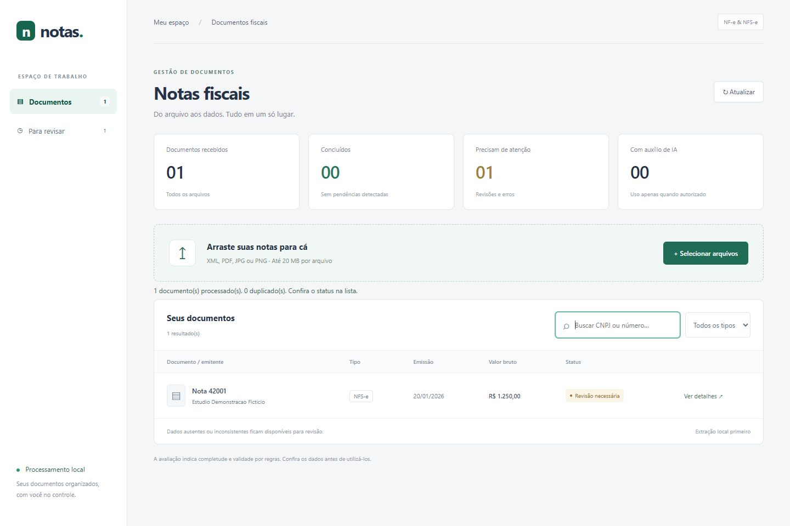
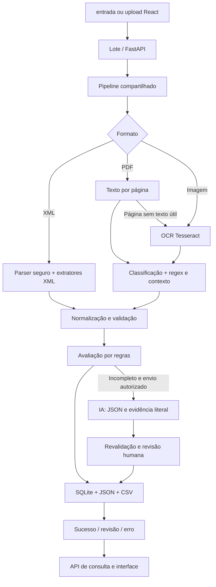

# Automação de notas fiscais

Extração local de **NF-e e NFS-e** em XML, PDF, PNG e JPEG, com organização em JSON, CSV e SQLite. API FastAPI e interface React + TypeScript + Vite. IA opcional apenas para extrações incompletas e mediante autorização explícita.



## Instalação

Ambiente verificado: Windows, Python 3.14, Node.js 24 e Tesseract com o idioma `por`. Use Python 3.12+ e Node.js 22.12+; outras versões/sistemas não foram verificados nesta entrega.

Na raiz do projeto, no PowerShell:

```powershell
python -m venv .venv
.\.venv\Scripts\python.exe -m pip install -r requirements-dev.txt
npm --prefix frontend ci
```

Para executar apenas o backend, `requirements.txt` é suficiente. SQLite faz parte do Python. Não é necessário instalar servidor de banco, SDK de IA ou bibliotecas de interface adicionais.

### Tesseract

Instale o Tesseract e os dados de idioma português (`por`), conforme a [documentação de instalação](https://tesseract-ocr.github.io/tessdoc/Installation.html). No Windows, configure o caminho correspondente à sua instalação:

```powershell
$env:TESSERACT_CMD = 'C:/Program Files/Tesseract-OCR/tesseract.exe'
$env:OCR_LANG = 'por'
& $env:TESSERACT_CMD --list-langs
```

No Linux, os pacotes usuais são `tesseract-ocr` e `tesseract-ocr-por`. Se o executável estiver no `PATH`, `TESSERACT_CMD` é dispensável. Sem Tesseract, XML e PDFs com texto continuam funcionando; imagens e páginas escaneadas registram erro de OCR.

## Executar a aplicação

Terminal 1, na raiz:

```powershell
$env:TESSERACT_CMD = 'C:/Program Files/Tesseract-OCR/tesseract.exe'
.\.venv\Scripts\python.exe -m uvicorn api:app --host 127.0.0.1 --port 8000
```

Terminal 2:

```powershell
npm --prefix frontend run dev
```

Abra [a interface](http://127.0.0.1:5173) e [o Swagger](http://127.0.0.1:8000/docs). O Vite encaminha `/api` ao backend local. Faça upload de um ou mais arquivos ou use drag & drop. Pesquise por CNPJ/número, filtre NF-e/NFS-e e abra **Ver detalhes** para consultar valores, qualidade, ausência de campos e erros.

A API é síncrona: o upload retorna o status final. A interface indica processamento enquanto aguarda a resposta. Use uma instância do backend, com um worker; esta versão é uma ferramenta local, sem autenticação ou fila distribuída. Não execute lote e API simultaneamente sobre a mesma pasta de dados: SQLite protege as inserções, mas as exportações em arquivo não têm coordenação entre processos.

Para gerar e verificar o build:

```powershell
npm --prefix frontend run build
npm --prefix frontend run preview
```

O preview também requer a API na porta 8000. A pasta `frontend/dist/` não contém backend e não deve ser publicada isoladamente esperando processamento fiscal.

## Processamento em lote

Coloque cópias dos documentos em `entrada/` e execute:

```powershell
.\.venv\Scripts\python.exe main.py
```

As pastas são criadas automaticamente. Defina `DADOS_DIR` para isolar os dados operacionais:

```powershell
$env:DADOS_DIR = 'C:/dados/notas-demo'
.\.venv\Scripts\python.exe main.py
```

Configure a mesma variável no terminal da API se quiser compartilhar esse banco. Por padrão, o diretório é a raiz do projeto.

| Destino | Conteúdo |
| --- | --- |
| `processados/` | Documentos sem ausências obrigatórias ou inconsistências detectadas |
| `revisao/` | Extrações incompletas, identificadores inválidos ou campos preenchidos por IA |
| `erros/` | Arquivos que não puderam ser lidos/classificados/extraídos |
| `duplicados/` | Cópias adicionais preservadas quando o destino já existe |
| `resultados/registros/<id>.json` | Resultado por nota, origem, status, erro e horário UTC |
| `resultados/notas.csv` | Consolidado com uma linha por nota extraída, inclusive em revisão |
| `resultados/resumo.json` | Contadores da última execução do lote |
| `notas.sqlite3` | Notas e associação dos hashes dos arquivos |

Documentos são movidos apenas depois da persistência/exportação. Se ocorrer falha operacional, o lote continua e mantém a entrada para recuperação. Falhas de extração também ficam registradas no banco/JSON; não viram linhas fiscais fictícias no CSV. A função legada `main.processar_arquivo()` permanece disponível para extrair/exportar um arquivo individual sem movê-lo.

A duplicidade é identificada por SHA-256 do conteúdo e, quando disponível, chave fiscal. Chaves NF-e com dígito inválido não são usadas como identidade. Arquivos com falha/revisão também são lembrados para evitar repetições e chamadas de IA. Ao reenviar um arquivo em erro/revisão registrado por uma versão antiga do extrator, o sistema reavalia e atualiza a mesma nota, sem criar outra linha. Resultados da versão atual continuam protegidos contra duplicação. Para repetir a mesma versão após mudar apenas configurações, utilize um novo `DADOS_DIR`. Sem chave confiável, representações diferentes da mesma nota podem exigir conferência manual.

## Exemplos fictícios

A pasta `exemplos/` contém NF-e/NFS-e XML, PDFs com texto, PDF escaneado, JPG, PNG e XML não fiscal. Todos os nomes e identificadores são fictícios. Identificadores zerados e chaves repetidas são intencionais: essas notas devem ir para **revisão**, não ser consideradas fiscalmente válidas.

```powershell
.\.venv\Scripts\python.exe gerar_demo.py
# Ou gere diretamente em uma pasta de demonstração isolada:
.\.venv\Scripts\python.exe gerar_demo.py --saida C:/dados/notas-demo/entrada
```

O gerador sobrescreve somente os nomes de exemplo conhecidos no destino indicado. Não aponte para uma pasta com documentos de produção que tenham esses nomes.

## Arquitetura



- `extratores/`: regras de NF-e/NFS-e em XML e texto de PDFs/imagens; reaproveitadas do projeto original.
- `processamento/leitor.py` e `ocr.py`: leitura por página e OCR com `--psm 3`, renderização de PDF a 300 DPI e pré-processamento condicional.
- `normalizador.py`, `validador.py`, `avaliador.py`: datas/valores/identificadores, dígitos verificadores e diagnóstico.
- `pipeline.py`: coordena extração local, normalização, IA opcional e reavaliação; não move arquivos.
- `ia.py`: uma chamada opcional à Responses API, JSON Schema, evidências e métricas.
- `lote.py`: tratamento por arquivo, organização das pastas, logs e exportações.
- `banco.py`: persistência SQLite transacional e consultas parametrizadas, sem ORM.
- `api.py`: uploads e consultas; reutiliza o mesmo processamento do lote.
- `frontend/`: interface responsiva, sem biblioteca visual adicional.

O formato original (`tipo`, `numero_nota`, `emitente`, `destinatario`, datas e `valor_total`) foi preservado. Foram acrescentados campos de líquido/ISS, `vencimentos`, validações, avaliação e metadados. `valor_total` representa **valor bruto**. `data_vencimento` mantém o primeiro vencimento encontrado; `vencimentos` preserva todas as datas identificadas. Ausência é `null`, nunca um valor inventado. Os registros do lote/API envolvem esses dados na propriedade `dados` e acrescentam status e origem.

### Regras de qualidade

Campos obrigatórios comuns: número, CNPJ do emitente e valor bruto. Para NF-e/NFS-e identificadas, também data de emissão e documento do destinatário; NF-e exige chave. Vencimento não é obrigatório. Algumas operações legitimamente não identificam destinatário; a regra conservadora ainda as encaminha para revisão.

- **Completude:** percentual dos campos obrigatórios presentes; valor zero conta como presente.
- **Validade:** percentual dos identificadores presentes que passam nas verificações matemáticas. Não verifica existência cadastral, autorização fiscal ou assinatura.
- **Confiança estimada:** alta somente sem ausências e sem inconsistências detectadas; baixa nos demais casos. É uma heurística explícita, não uma probabilidade.
- Valor negativo, líquido superior ao bruto e identificadores inválidos exigem revisão. Valores não finitos são normalizados para ausência.
- Campos ausentes habilitam uma segunda tentativa via IA, somente para tipo fiscal já reconhecido e com texto disponível. Apenas identificador inválido não provoca chamada de IA.

## IA opcional e economia de tokens

O processamento local funciona sem chave. `.env.example` é uma referência de configuração; **não há carregamento automático de `.env`**. Defina variáveis no processo que inicia o programa:

```powershell
# Configure OPENAI_API_KEY de forma privada no seu ambiente.
$env:IA_MODELO = 'identificador-do-modelo-da-sua-conta'
$env:IA_HABILITADA = '1'
$env:IA_ENVIO_AUTORIZADO = '1'
```

Só habilite as duas opções depois de autorizar o envio dos dados envolvidos e verificar o tratamento adequado das informações. A autorização por ambiente se aplica aos documentos processados nessa execução. Nenhum documento foi enviado a serviços de IA durante o desenvolvimento/testes.

A integração usa [Structured Outputs na Responses API](https://developers.openai.com/api/docs/guides/structured-outputs). Selecione um modelo da sua conta compatível com esse recurso; não há modelo/preço implícito.

Para economizar, XML/texto/OCR e regex têm prioridade. O fallback recebe somente campos ausentes e trechos fiscais (até 12 mil caracteres), faz no máximo uma chamada por processamento e limita a saída a 1.800 tokens. Não envia o arquivo original nem imagens. Documentos completos, não fiscais ou sem texto não acionam a IA. Extrações XML não têm fallback externo nesta versão.

A resposta deve citar evidência literal, conter o valor nessa evidência e preencher apenas campos ausentes permitidos. Valores existentes são preservados. Mesmo assim, ocorrência textual não prova associação semântica ao campo: toda nota com campos aceitos da IA exige conferência humana. JSON inválido, recusa/resposta incompleta, timeout ou falha de rede preservam a extração local.

Os metadados registram chamadas, uso de IA, campos aceitos, erro, estimativa simples de tokens de entrada e tokens retornados pela API. Custo estimado é calculado somente se forem definidos `IA_PRECO_ENTRADA_MILHAO` e `IA_PRECO_SAIDA_MILHAO` em USD; não substitui o faturamento do provedor. `store=false` é enviado, mas não constitui garantia geral de retenção zero pelo serviço.

## API

| Método | Rota | Uso |
| --- | --- | --- |
| POST | `/api/upload` | Multipart com campo `arquivo`; limite de 20 MB |
| GET | `/api/notas` | Lista; `tipo`, `busca`, `limite` (1–500), `deslocamento` |
| GET | `/api/notas/{id}` | Registro completo |
| GET | `/api/processamentos/{id}` | Status final, erro e horário |
| GET | `/docs` | Swagger automático |

Valida extensão, tamanho, arquivo vazio e assinatura de PDF/imagem. A rota rejeita declarações DTD/entidades identificadas no conteúdo; o parser também impede expansão de entidades. MIME fornecido pelo cliente não é usado como prova de formato. Nome de upload não pode escolher caminhos fora da pasta temporária. Um upload aceito que falha na extração retorna HTTP 200 com `status=erro`; erros de validação do upload usam HTTP 400, 413 ou 415. Não há processamento assíncrono em segundo plano.

## Testes

```powershell
.\.venv\Scripts\python.exe -m pytest -q
# OCR real opcional:
$env:TESSERACT_CMD = 'C:/Program Files/Tesseract-OCR/tesseract.exe'
$env:TESTAR_OCR_REAL = '1'
.\.venv\Scripts\python.exe -m pytest -q
npm --prefix frontend run build
```

Resultado verificado em 14/10/2026: **62 aprovados + 3 ignorados** na suíte padrão; **65 aprovados** com OCR real habilitado. Inclui XML/PDF NF-e e NFS-e, imagens e PDF escaneado, incompletos, corrupção, documentos não fiscais, CNPJ inválido, ausência/multiplicidade de vencimentos, lote, SQLite/duplicidade, IA com mocks e API. A fixture automática desliga a IA e bloqueia o transporte externo. Nenhuma chave ou serviço pago é necessário.

No navegador foram verificados upload de XML fictício, listagem, detalhe, pesquisa, filtro e estados de revisão; layouts de 390 px e desktop também foram inspecionados. [Captura estreita](docs/interface-mobile.jpg). Não foi realizada validação em celular físico.

## Limitações conhecidas

- Layouts municipais de NFS-e variam: o parser XML cobre o namespace ABRASF usado nos exemplos, o retorno municipal paulistano (`RetornoConsulta/NFe`, com ou sem namespace) e o de NF-e o namespace do Portal Fiscal. Padrões nacionais/municipais diferentes podem precisar de novos adaptadores.
- PDFs com texto são lidos preservando as colunas. Cabeçalhos e linhas de valores são associados por coluna, e a seção de totais tem prioridade sobre itens individuais. RPS não substitui número da NFS-e. O formato municipal denominado `NFe` é classificado como NFS-e por sua estrutura.
- PDF/imagem depende de rótulos e contexto textual reconhecíveis. Tabelas com ordem de leitura ambígua, fotos inclinadas, baixa nitidez e texto manuscrito podem gerar campos ausentes. OCR não garante recuperação de imagens ruins.
- O leitor considera texto útil a partir de 20 caracteres por página; cabeçalhos em páginas com corpo escaneado podem impedir OCR automático. Não há análise visual de layout ou retentativas múltiplas de OCR.
- Uma nota por documento. Não há separação de arquivos com várias notas nem suporte a XML compactado/ZIP, assinatura digital ou consulta à SEFAZ/prefeituras.
- Somente CPF/CNPJ numéricos. Identificadores alfanuméricos e regimes tributários específicos não são tratados.
- ISS, base, alíquota e retenção são extraídos quando o layout expõe rótulos suportados. Não há cálculo/reconciliação tributária completa.
- Sem chave confiável, cópias em formatos diferentes podem não ser reconhecidas como duplicadas. Não há edição/aprovação manual dos campos pela interface.
- A API/processamento são locais e síncronos. O limite de upload não substitui limites de infraestrutura para exposição pública. Não há autenticação ou garantia de recuperação automática de exportações após falhas de disco.
- O limite de 12 mil caracteres pode deixar evidências de IA de fora. A integração externa foi testada com mocks, não com chamada paga real.

## Organização para GitHub

`.gitignore` exclui ambientes, caches, credenciais, banco local e documentos operacionais. Exemplos e fixtures publicados no estado atual são fictícios. Arquivos operacionais e caches anteriormente rastreados foram removidos apenas do índice do Git, preservando os arquivos locais. **O histórico anterior pode conter dados:** a limpeza do estado atual não reescreve commits passados; revise o histórico antes de tornar o repositório público. Não houve push nem publicação automática.

Veja [o relatório de implementação](docs/RELATORIO.md) para a análise inicial, fases, validação e commits.
