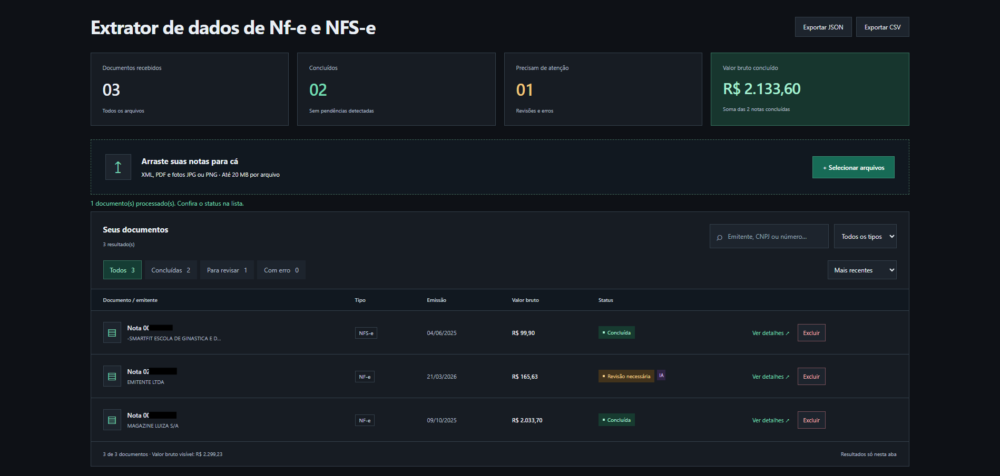

# Extrator de Notas Fiscais

Aplicação para extrair, organizar e revisar informações de notas fiscais brasileiras **NF-e e NFS-e** a partir de arquivos XML, PDF e imagens.

O projeto identifica campos como número da nota, emitente, destinatário, data de emissão e valor total. Quando os dados extraídos estão incompletos ou precisam de conferência, o documento pode ser sinalizado para revisão.



## Como funciona

O projeto possui dois modos de uso: uma aplicação web e uma automação local para processamento em lote.

### 1. Aplicação web

- Envio de arquivos por upload ou arrastar e soltar.
- Extração de dados de XML e PDF, com OCR para PDFs digitalizados e imagens.
- Uso opcional de IA como apoio quando a extração local não é suficiente.
- Visualização, pesquisa, filtros e detalhes dos resultados.
- Exportação dos resultados em JSON e CSV.

**Privacidade:** os arquivos enviados são processados temporariamente pela API. A aplicação web não mantém um histórico no servidor; os resultados ficam na memória da aba do navegador e são perdidos ao recarregar ou fechar a página.

### 2. Automação local com processamento em lote

A automação local permite processar vários documentos a partir da pasta `entrada/`.

Após a execução, os arquivos são organizados conforme o resultado do processamento, em pastas como:

- `processados/`
- `revisao/`
- `erros/`

Os dados extraídos são salvos em arquivos JSON e CSV dentro de `resultados/`. O modo local também utiliza o banco SQLite `notas.sqlite3` para manter registros e apoiar o controle de duplicados.

Esses arquivos e pastas são gerados localmente e não devem ser enviados ao GitHub quando contiverem dados fiscais reais.

## Tecnologias utilizadas

- **Python** — processamento e extração de dados.
- **FastAPI** — API da aplicação web.
- **React, TypeScript e Vite** — interface web.
- **PyMuPDF e pypdf** — leitura de PDFs.
- **Tesseract OCR** — reconhecimento de texto em imagens e PDFs digitalizados.
- **SQLite** — histórico da automação local.
- **Gemini (opcional)** — apoio à extração de informações.
- **Pytest** — testes automatizados.

## Requisitos

- Python 3.12 ou superior.
- Node.js 22.12 ou superior.
- Tesseract OCR instalado, com o idioma português (`por`), para processar imagens e PDFs digitalizados.

Os comandos abaixo foram preparados para PowerShell no Windows.

## Como executar a aplicação web

### 1. Criar o ambiente Python

Na raiz do projeto, execute:

```powershell
python -m venv .venv
.\.venv\Scripts\python.exe -m pip install -r requirements.txt
```

### 2. Instalar as dependências do frontend

```powershell
npm --prefix frontend ci
```

### 3. Configurar as variáveis de ambiente

Se o arquivo `.env` ainda não existir, crie-o a partir do modelo:

```powershell
if (-not (Test-Path .env)) { Copy-Item .env.example .env }
```

A configuração da IA é opcional. Consulte a seção **Configurar a IA opcional** abaixo se quiser habilitá-la.

### 4. Iniciar a API

Em um terminal, execute:

```powershell
.\.venv\Scripts\python.exe -m uvicorn api:app --host 127.0.0.1 --port 8000
```

A documentação interativa da API ficará disponível em:

[http://127.0.0.1:8000/docs](http://127.0.0.1:8000/docs)

### 5. Iniciar o frontend

Em outro terminal, execute:

```powershell
npm --prefix frontend run dev
```

Abra a aplicação no navegador:

[http://127.0.0.1:5173/](http://127.0.0.1:5173/)

## Como executar a automação local

1. Coloque os documentos que deseja processar na pasta `entrada/`.
2. Na raiz do projeto, execute:

```powershell
.\.venv\Scripts\python.exe main.py
```

3. Consulte os documentos organizados nas pastas de saída e os arquivos JSON/CSV em `resultados/`.

O modo local utiliza `notas.sqlite3` para registrar informações do processamento. Antes de processar documentos reais, confira se as pastas de entrada e saída estão configuradas corretamente e evite compartilhar arquivos fiscais no repositório público.

## Configurar a IA opcional

A extração local funciona sem a IA. Para habilitar o recurso, configure no arquivo `.env`:

```dotenv
GEMINI_API_KEY=sua-chave
IA_HABILITADA=1
IA_ENVIO_AUTORIZADO=1
IA_ENVIO_IMAGEM=0
```

- `GEMINI_API_KEY`: chave de acesso ao serviço.
- `IA_HABILITADA`: habilita o recurso de IA.
- `IA_ENVIO_AUTORIZADO`: indica que o envio de dados para o serviço externo foi autorizado.
- `IA_ENVIO_IMAGEM`: controla se imagens podem ser enviadas à IA; mantenha `0` para não enviar imagens.

**Atenção:** o uso da IA pode enviar trechos de texto extraídos de documentos para um serviço externo. Se o envio de imagens estiver habilitado, imagens também poderão ser transmitidas. Notas fiscais podem conter dados pessoais ou empresariais; utilize esse recurso somente quando estiver de acordo com as implicações de privacidade.

Mantenha o arquivo `.env` fora do Git. O arquivo `.env.example` deve conter apenas nomes de variáveis e valores ilustrativos, nunca chaves reais.

## Testes

Para instalar as dependências de desenvolvimento e executar os testes automatizados:

```powershell
.\.venv\Scripts\python.exe -m pip install -r requirements-dev.txt
.\.venv\Scripts\python.exe -m pytest -q
npm --prefix frontend run build
```

Os testes automatizados não precisam realizar chamadas reais à IA. Para executar os testes de OCR real, com o Tesseract instalado e configurado, defina a variável abaixo antes de rodar os testes:

```powershell
$env:TESTAR_OCR_REAL='1'
.\.venv\Scripts\python.exe -m pytest -q
```

## Limitações conhecidas

- O sistema não valida as notas diretamente junto à SEFAZ ou às prefeituras.
- A assinatura digital dos documentos não é verificada.
- Arquivos que contenham várias notas fiscais podem exigir tratamento separado.
- Layouts incomuns, documentos incompletos ou imagens de baixa qualidade podem gerar campos pendentes de revisão.
- A extração automática é uma ferramenta de apoio e os dados devem ser conferidos antes de serem utilizados em processos fiscais ou financeiros.

## Segurança e privacidade

- Não publique arquivos `.env`, bancos SQLite, resultados de processamento ou notas fiscais reais.
- A aplicação web não possui autenticação. Antes de disponibilizá-la publicamente, implemente proteções adequadas, como autenticação, limites de uso e controles contra abuso.
- Os resultados exportados em JSON ou CSV podem conter dados fiscais. Guarde-os em local seguro.
- Utilize documentos fictícios ou anonimizados em demonstrações e capturas de tela.

## Objetivo do projeto

Este projeto foi desenvolvido como estudo prático de Python, extração de dados, OCR, APIs e integração entre backend e frontend, com foco em automatizar parte do trabalho de organização de notas fiscais.
